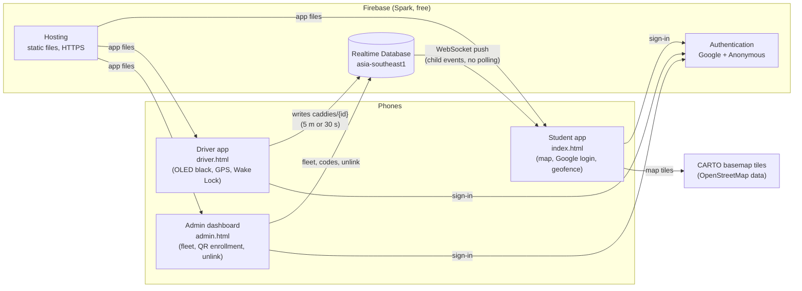

# SNU Caddy: system design and security architecture

This document is for the Shiv Nadar University IT department. It describes
how SNU Caddy works, how it protects data, how it stays on the free tier,
and how it handles failures.

- **Product:** a live map of campus caddies (golf-cart shuttles) for students.
  Each caddy is **Moving**, **Parked**, **Charging**, **Signal lost** or
  **Offline**, with the time of its last update. (There is no seat status:
  students hop on and off at every block, so drivers do not tap anything
  while they drive. The one driver action is **Charging** (two taps), for a parked caddy.)
- **Platform:** a Progressive Web App (PWA): HTML, CSS and JavaScript. No app
  store. It works on iPhone, Android, and Android without Google Play Services
  (GrapheneOS, LineageOS, CalyxOS).
- **Backend:** Firebase (Google) on the free **Spark** plan: Authentication,
  Realtime Database, Hosting. No servers and no Cloud Functions.

## 1. Components



| Part | File | Who uses it |
| ---- | ---- | ----------- |
| Student app | `index.html`, `js/main.js`, `js/live.js` | Students and staff with an `@snu.edu.in` Google account |
| Driver app | `driver.html`, `js/driver-screen.js`, `js/driver-shift.js` | One dedicated Android phone per caddy |
| Service worker | `sw.js` | Opens the app shell in dead zones; never caches live data |
| Admin dashboard | `admin.html`, `js/admin.js` | SNU accounts on the admin list |
| Security rules | `database.rules.json` | Enforced by Firebase on every read and write |
| Tests | `tests/*.test.mjs`, `tests/e2e/` | 36 rules tests in the emulator + 75 unit tests (`npm test`); 5 browser tests under the real CSP (`npm run test:e2e`); both run in CI on every PR |

## 2. Roles and sign-in

| Role | Sign-in | Why |
| ---- | ------- | --- |
| **Student** | Google sign-in, restricted to `@snu.edu.in` | SNU uses Google Workspace. It is standard web OAuth in the browser, so it works without Google Play Services. The session stays until sign-out. |
| **Driver phone** | Firebase **Anonymous** sign-in + one-time **device binding** | Drivers have no SNU accounts. The phone gets a permanent device identity (a Firebase uid). An admin links that uid to one caddy with a single-use QR code. Drivers never log in. |
| **Admin** | Google sign-in (`@snu.edu.in`) **and** listed under `admins/{uid}` | The admin list is edited only in the Firebase console, never from the app. |

Email-link sign-in is not used: the free plan allows only 5 such emails per day.

### Driver device binding (QR enrollment)

```mermaid
sequenceDiagram
  participant Admin as Admin dashboard
  participant DB as Realtime Database
  participant Phone as Driver phone
  Admin->>DB: enrollCodes/{code} = {caddyId, expiresAt: +10 min}
  Note over Admin: Shows QR (link with #enroll=code) and typed code
  Phone->>Phone: 5 taps on the name, scan QR (or camera app opens link)
  Phone->>Phone: Anonymous sign-in (uid = device identity)
  Phone->>DB: ONE atomic update:<br/>drivers/{uid} = {caddyId, code}<br/>enrollCodes/{code}/usedBy = uid
  DB-->>Phone: Rules accept only if the code exists, is unused,<br/>is not expired and matches the caddy
  Phone->>Phone: Save hint in localStorage, open driver.html
  Admin->>DB: Unlink = delete drivers/{uid}
  DB-->>Phone: Next write is denied; the open listener shows "unlinked"
```

- The setup code has **120 random bits** (24 characters, Crockford base32).
  It works **once** and expires after **10 minutes** (the rules allow at most 30).
- The code list cannot be read or listed by non-admins, so a code cannot be
  found by guessing. There is **no short PIN** to brute-force.
- `localStorage` holds only a hint (`caddy_03`) so that the phone opens the
  driver screen at once. The real permission is `drivers/{uid}` in the
  database, checked by the rules on every write.
- Firebase keeps the anonymous session in IndexedDB. The driver page asks the
  browser for persistent storage on every start. Chrome grants it once the app
  is installed (Add to Home screen), so the setup guide makes installing a
  required step. Then Android does not clear the session under storage pressure.

## 3. Data model: one small object per caddy

The database stores the **current state** only. A new GPS fix **overwrites**
the caddy's object; there is no location history. The whole database stays
under a few kilobytes.

```jsonc
{
  "admins":  { "<uid>": true },
  "fleet":   { "caddy_01": { "name": "Caddy 01" } },
  "caddies": {
    "caddy_01": {
      "lat": 28.52471, "lng": 77.57412,  // inside the campus box (rules)
      "bearing": 92,                      // degrees, only while moving
      "accuracy": 6,                      // metres, at most 20 (rules)
      "online": true,                     // false = off shift / disconnected
      "charging": false,                  // true = parked and plugged in (optional, the driver sets it)
      "lastUpdated": 1792147071000,       // server time of the last data (rules)
      "movedAt": 1792147069000            // server time of the last real move (optional)
    }
  },
  "drivers":     { "<anonymous uid>": { "caddyId": "caddy_01", "code": "…", "enrolledAt": 0, "device": "Android 14 · Chrome 130" } },
  "enrollCodes": { "<24-char code>": { "caddyId": "caddy_01", "createdAt": 0, "createdBy": "<admin uid>", "expiresAt": 0, "usedBy": "<uid>", "usedAt": 0 } }
}
```

Size: about 200 bytes per caddy. Old setup codes are deleted by the admin
dashboard (expired ones at once, used ones after 24 hours).

**States on the student map** (`js/caddy-state.js`), from four fields:

| State | Rule | On the map |
| ----- | ---- | ---------- |
| Moving | `online` and data less than 90 s old and `movedAt` less than 60 s old | Normal icon, green dot |
| Parked | `online` and data less than 90 s old, no real move for 60 s | Normal icon, blue dot |
| Charging | `online`, data less than 90 s old, and `charging` is `true` | Normal icon at its parked place, purple dot |
| Signal lost | `online`, but no data for 90 s or more | Dimmed icon, amber dot |
| Offline | `online` is `false` (Go offline, or `onDisconnect`) | Grey icon, "Last seen …" |

A "real move" is decided on the driver phone: GPS speed of at least 1 m/s,
or (without speed) at least 10 m and more than the error radius from the
place of the last move. So GPS noise cannot make a parked caddy "move".

Precedence: Offline, then Signal lost, then Charging, then Moving / Parked.
A charging phone that disconnects shows Offline; one that goes quiet shows
Signal lost. `charging` is a flag the driver sets with two taps (the first
shows a confirm label, like Go offline); the rules
accept it as a boolean, on its own (it is not a position, so it needs no new
`lastUpdated`). Every position write carries it, so a flag that was lost in a
dead zone is corrected by the next heartbeat (at most 30 s). The toggle is
written at once only while the connection is up and after the first position
write has started; otherwise the next position write carries it. Driving off
clears it: a real move that also takes the caddy 30 m or more from the
charger (`DRIVER.chargeClearM`), and farther than the error radii of the two
fixes added together, so GPS drift of a parked phone, which can pass the 10 m
Moving test now and then, does not. The charger is the first fix less than
`DRIVER.fixFreshMs` old after the tap (after a GPS dead zone, the next fresh
one). GO starts a shift as not charging (its first write says
`charging: false`). Go offline, the `onDisconnect` hook, the stale-shift
cleanup on the driver phone and an admin's Unlink all write `online: false,
charging: false`, so the node never keeps a stale `charging: true`. Only the
off-campus mark writes `online: false` alone (the shift is still charging, and
the next on-campus write carries the flag). A reload during a shift keeps the
flag and the charger's place (both saved with the shift).

## 4. Real-time data flow

1. **Driver phone** (`js/driver-shift.js`): after **GO**, `watchPosition`
   with `enableHighAccuracy: true` and `maximumAge: 0`. Each fix goes
   through one shared gate (`js/lib/ping-gate.js`):
   - drop the fix if its error radius is more than **20 m**;
   - drop it if it is outside the campus fence + 100 m (the driver's
     location is never shared off campus; the caddy shows as offline);
   - send it only if it is the first fix, the caddy moved **5 m** from the
     last sent fix, or **30 s** passed (heartbeat). A browser that reports
     only changes gets asked for a fresh fix when the heartbeat is due.

   Then a sender limits the writes: one write in flight at a time, at most
   one every **2 s** (the newest fix wins), never while the connection is
   down. Each write is one `update()` of the caddy object with
   `online: true` and `lastUpdated: ServerValue.TIMESTAMP`, plus
   `movedAt: ServerValue.TIMESTAMP` when the caddy really moved, and the
   `charging` flag.
2. **Database**: the write overwrites `caddies/{id}`. The rules check the
   sender, the fields, the campus box, and the server timestamps. A GPS field
   (lat, lng, bearing, accuracy) and `movedAt` can change only together with
   a new server timestamp, at most once per second per caddy. Going offline
   is not rate-limited.
3. **Student phones** (`js/live.js`): child listeners on `caddies` and one
   listener on `fleet` (names) receive each change over the same WebSocket.
   There is **no polling**. Server times are moved to the phone's clock with
   `.info/serverTimeOffset`, so a wrong phone clock cannot fake "Signal
   lost". The icon glides to the new point and turns to the direction of
   travel. Every 5 s the app checks the time-based states (Moving → Parked,
   → Signal lost).
4. **Connections and battery**: student phones listen only while the app is
   on screen, the student is signed in, the phone is on campus, demo mode is
   off, and the student touched the app in the last **5 minutes**. In all
   other cases the app removes the listeners **and closes the connection**
   (`goOffline`). A tap brings everything back in about a second. This keeps
   the number of open connections low (the free plan allows 100).

### Driver shift: presence and recovery

| Moment | What the phone does |
| ------ | ------------------- |
| GO | Screen Wake Lock on, GPS watch on. The first sharp fix creates or overwrites the caddy object. |
| First confirmed write on a connection | Registers `onDisconnect().update({ online: false })`. (The rules accept it only for an existing caddy object, so it comes after the write.) |
| Connection lost (dead zone) | No new writes. At most one write that was already in flight stays in the SDK. The server runs `onDisconnect`: students see the caddy offline. |
| Connection back | `onDisconnect` is registered again at once. The SDK re-sends the in-flight write (its server times resolve now, so the old place shows for about 1 s); about 1 s after its answer, the newest fix goes out with `online: true`. |
| Connection "up" but writes get no answer (half-open link) | After 60 s without a confirmed write, the driver screen says "Not reaching the server" (students see "Signal lost" at 90 s). |
| Old connection's `onDisconnect` runs late | Every position write carries `online: true`, so the next write (at most 30 s later) corrects it. |
| Outside campus | No positions; `online: false` once. Back inside: the next fix makes it online again. |
| App in the background | The browser stops GPS and timers. Students see "Signal lost" after 90 s. Back within 10 min: the shift continues. After 10 min: the shift ends, so a forgotten phone leaves no ghost caddy. |
| Reload or crash during a shift | The shift resumes by itself if it was alive in the last 10 min. Otherwise the screen says why GO is back, and the phone sets its caddy `online: false, charging: false` (no ghost caddy, even if the old connection dropped before `onDisconnect` was registered). |
| Go offline while the first write still waits (dead socket) | `online: false` is still sent; the SDK delivers it after the waiting write, so the caddy ends offline. |
| Charging confirmed (second tap) | `charging` is written at once (only while the connection is up). The driver app must stay open: if the phone is locked, students see "Signal lost" after 90 s, and "Offline" only when the phone drops its connection (not on a timer) or when the driver reopens the app after 10 min. |
| Go offline (two taps) | `online: false, charging: false`, then `onDisconnect` cancelled; GPS and wake lock off. |
| Admin unlinks the phone | The `drivers/{uid}` listener fires: the shift stops at once, the phone returns to the student app. The admin page sets `online: false, charging: false`. |
| Writes refused (for example the caddy was removed from the fleet) | Back-off (2, 4, 8 … 30 s); after 3 in a row the screen says "Ask an admin". |

The driver screen is OLED-black: a pure `#000` background and little lit
text. One large headline gives the status in colour (green "Online", purple
"Charging", amber for a warning, red for an error) with one plain sentence below it. It dims
after 20 s without a touch (an error lights it again at once, a warning
after 10 s) and moves its content by a few pixels every minute, so hours of
a still picture cannot burn in.

## 5. Security rules (enforced by Firebase)

| Path | Read | Write |
| ---- | ---- | ----- |
| `caddies` | Verified `@snu.edu.in` accounts | Only the phone bound to **that** caddy (validated fields). Admins may force it offline. |
| `fleet` | Verified `@snu.edu.in` accounts; a bound phone reads its own caddy | Admins |
| `drivers/{uid}` | That phone; admins | The phone itself, **only** together with a valid code claim. Admins may delete (unlink). |
| `enrollCodes/{code}` | Anyone signed in **who knows the exact code**; admins may list | Admins create/delete. A phone may only claim an unused, unexpired code once. |
| `admins/{uid}` | That user (to check own status) | Nobody from the app (console only) |
| Everything else | Nobody | Nobody |

Validation on `caddies/{id}`: lat/lng inside the campus box (also protects
the driver's privacy off campus), `accuracy` ≤ 20 m, `bearing` 0–360,
`online` and `charging` booleans, `lastUpdated` = server time, `movedAt` = server time (and
only together with a new `lastUpdated`), no extra fields (a `status` field
is refused), and the caddy must exist in `fleet`. GPS fields change only
with a new `lastUpdated`, at most once per second.

The rules are tested with the Firebase Emulator: 35 tests, one per attack
or allowed action, including the exact writes a driver phone makes in a
shift (`npm test`). The shift engine has 42 more tests with a fake GPS, a
fake database and fake timers; the map states have 4 tests, and other tests
keep the service worker list, the CSP hashes, the preload lists and the
pinned CDN versions in sync (`npm run test:unit`, no emulator needed). Five
browser tests open the three pages in Chromium, served by the Hosting
emulator with the real headers, so a CSP that blocks something fails CI
(`npm run test:e2e`).

### Content-Security-Policy and service worker

Firebase Hosting sends a strict CSP with every page (`firebase.json`):

- `default-src 'self'`; no `unsafe-inline`, no `unsafe-eval`. The four small
  inline scripts (index.html: driver redirect + module preload, and theme
  before first paint; driver.html: redirect back to the student app;
  admin.html: theme) are allowed by their SHA-256 hash only.
  `tests/csp.test.mjs` fails when one of them changes.
- Scripts: this site, the exact package paths on the CDNs
  (`unpkg.com/leaflet@1.9.4/`, `www.gstatic.com/firebasejs/12.19.0/`,
  `cdn.jsdelivr.net/npm/jsqr@1.4.0/`, `cdn.jsdelivr.net/npm/qrcode-generator@2.0.4/`;
  never a whole CDN, which could serve any package), Google sign-in
  (`apis.google.com`), and the database hosts (needed only by the
  long-polling fallback on networks that block WebSockets).
- Images: this site, CARTO and OpenStreetMap tiles. Frames: the project's
  sign-in domain, Google accounts, and the database hosts (long polling).
- The `127.0.0.1` entries let the same headers work with the local
  emulators (`firebase emulators:start`); they only reach the same computer.
- `frame-ancestors 'none'`: no other site can frame SNU Caddy.

The policy was tested with the same headers on a local server: the student
flow (sign-in, live map, idle pause, demo, offline reload), the driver
flow and the admin flow ran with **no CSP violations**.

The service worker (`sw.js`) uses **network first** for the app files (a
new version is used at once). A page opens from the saved copy only when
the network fails or takes more than 4 s; that page then also gets its
modules from the saved copy, so one page never mixes two versions after a
deploy. The version-pinned CDN files are **cache first**. It keeps one
saved copy per page (query strings such as `?demo=1` share it) and never
touches live data, sign-in, Firebase's `/__/` pages or map tiles.

## 6. Threat model

| Threat | Mitigation |
| ------ | ---------- |
| A student pretends to be a driver | Writes to `caddies/{id}` need a binding in `drivers/{uid}`, which needs a one-time admin code. Anonymous sign-in alone gives no access (tested). |
| A driver phone is lost or stolen | Admin taps **Unlink**: the binding is deleted, writes fail at once, and the caddy is set offline. |
| Someone photographs a setup QR | Single use, 10-minute life, and the admin sees which phone used it (and can unlink it). |
| Guessing setup codes | 120-bit codes, and the code list cannot be read. No short PIN. |
| Non-SNU people read caddy positions | Rules need a **verified** `@snu.edu.in` email. Look-alike domains (`@snu.edu.in.evil.com`) fail (tested). Non-SNU Google accounts are deleted right after sign-in. |
| The Firebase web config is "public" | It is public by design. Security is in the rules, not in the config. Optional: restrict the browser API key to the app's domains (setup guide). |
| A bound phone sends junk or floods writes | Field validation, campus box, accuracy limit, server timestamps, and at most 1 position write per second (GPS fields and `movedAt` cannot change without a new timestamp; tested). An abusive phone is unlinked. |
| A setup QR is replaced or left on screen | When the admin creates a new code, signs out or closes the page, the unused code is deleted at once. Unused codes also expire after 10 minutes. |
| Driver location outside work | The phone shares only between GO and Go offline, and stops at the campus fence + 100 m. The rules also reject positions outside the campus box. |
| Student location privacy | The geofence check runs **on the phone**. The location is never sent or stored. |
| Ghost caddies (dead battery, closed app, dead zone) | `onDisconnect()` sets `online: false` on the server (tested). Students also dim any caddy whose `lastUpdated` is older than **90 s** and label it "Signal lost". |
| Script injection (XSS) | All text goes into the page with `textContent`. A strict Content-Security-Policy allows only this site's scripts, hashed inline scripts and the pinned CDNs (see section 5). Leaflet, jsQR and qrcode-generator are pinned and use Subresource Integrity. The Firebase SDK is pinned to 12.19.0 on Google's gstatic CDN; it loads as ES modules, which cannot carry SRI. Pages cannot be framed (`frame-ancestors 'none'`). |
| A bad CDN file or a cached old version | The service worker caches only version-pinned CDN URLs, and same-origin files with network first; it never caches live data or sign-in. |
| Students who graduate or leave | Firebase keeps a session until sign-out, even after the Google Workspace account is disabled. Options for IT: (a) disable or delete old users in Firebase Authentication each semester, or (b) add one rule line that requires a fresh sign-in every N days (`auth.token.auth_time`). The current build keeps students signed in, as requested. |
| Geofence bypass with developer tools | Accepted: the geofence is a usage policy, not a security boundary. The data is protected by the SNU login. |

## 7. Free-tier budget (Spark plan)

| Limit | Free amount | Our use |
| ----- | ----------- | ------- |
| Database storage | 1 GB | A few KB (state overwrite, no history) |
| Database download | 10 GB/month (~360 MB/day) | About 1–2 MB per student per hour of viewing (each moving caddy writes at most once every 2 s; a parked one every 30 s). Sessions are short (open, look, close), and listeners stop when the app is hidden. |
| Simultaneous DB connections | **100** | Driver phones (one per caddy) + students who have the app **on screen, on campus, and touched it in the last 5 minutes**. In every other case the student app closes its connection. |
| New accounts | 100 per hour per IP address | Campus Wi-Fi shares IP addresses, so plan a staggered launch. The app says "Too many sign-ins from this network right now. Wait a few minutes, or use mobile data." |
| Email-link sign-in | 5 emails/day | Not used. |
| Daily active users | 3,000/day **only** if the project is upgraded to "Identity Platform" | Do **not** upgrade. Standard Firebase Auth is enough. |
| Hosting | 10 GB storage, 360 MB/day transfer | App files are about 200 KB and are sent with `no-cache`, so repeat visits are mostly small "not changed" (304) answers. The service worker copy is used only when the network fails or is slow. Leaflet and the Firebase SDK come from public CDNs. |
| CARTO basemap tiles | 5 million requests/month (non-commercial key) | Tiles are cached for 30 days by the browser. |

If SNU grows past 100 viewers at the same moment, the next step is the
Blaze (pay-as-you-go) plan: it keeps the free quotas and raises the
connection limit to 200,000. At this data volume the cost would be very low,
but it needs a billing account. That is a decision for SNU IT.

## 8. Failures and edge cases

| Situation | What happens |
| --------- | ------------ |
| GPS fix is blurry (> 20 m) | Dropped on the phone, and the rules reject it too. |
| Caddy parked for a long time | One heartbeat every 30 s. If the browser reports no new fix, the phone asks the GPS for one. |
| Driver drives through a dead zone | No writes are queued. The server sets `online: false` (`onDisconnect`). On reconnect the phone sends only its newest fix and registers `onDisconnect` again (`.info/connected`). |
| Phone battery dies, app is killed | The server runs `onDisconnect`: `online: false`. |
| Phone clock is wrong | All times are server time (`ServerValue.TIMESTAMP`); students use the server time offset for the 90 s and 60 s checks (tested with a phone clock 10 minutes fast). |
| Student switches app or locks the phone | Page Visibility API: no GPS, no timers, database connection closed. |
| Student leaves the app open on a desk | After 5 minutes without a touch, live updates pause and the connection closes. A bar says "Live map paused. Tap to resume." |
| Student opens the app in a dead zone | The service worker serves the app; the list says "Connecting…" until the database answers. |
| Network blocks WebSockets | The Firebase SDK falls back to long polling (allowed by the CSP). |
| Student is off campus | "You are outside campus. Caddies show here when you are on campus." No data is loaded. |
| Student denies location | The sheet explains why location is needed and that it stays on the phone. No data is loaded. |
| Site opened over plain `http://` | Location needs HTTPS; the app says so. |
| Non-SNU Google account | The account is removed again, and the app asks for an `@snu.edu.in` account. |
| Too many sign-ups from one network | Clear message; try again later or on mobile data. |
| Setup code expired or already used | Clear message; the admin makes a new code. |
| Driver phone storage was cleared | The phone opens the student app; the admin links it again. |
| Phone unlinked while driving | The shift stops at once and the driver screen shows "An admin unlinked this phone". |
| Driver denies location | The shift does not start; the screen explains how to allow location in Chrome. |
| Driver leaves campus during a shift | Location not shared; the caddy shows offline until it is back. |
| Screen Wake Lock refused (battery saver) | The screen says the screen can turn off; every tap tries again. |
| A bad value in the published web config | Students see "SNU Caddy has a setup problem"; driver phones say "Setup problem. Tell an admin" and try again every minute, so they recover by themselves when a fixed version is published. |
| A student phone becomes a driver phone (5 taps) | The student is signed out and the phone is linked; the database connection is opened again for the link. |
| Installed iPhone app (standalone) | Sign-in uses a full-page redirect instead of a popup. |
| No Google Play Services | Nothing in the app needs them: web OAuth, W3C Geolocation, WebSocket. |

## 9. Delivery phases

| Phase | Scope | Status |
| ----- | ----- | ------ |
| 1 | Uber-style map, bottom sheet, theme (Auto/Light/Dark), demo/pitch mode | Done |
| 2 | Firebase project, `@snu.edu.in` login, geofence, QR device binding, admin dashboard, security rules + tests | Done |
| 3 | Driver screen: GO → Online (or Charging) → Go offline, GPS gate, Screen Wake Lock, `onDisconnect`, dead-zone recovery | Done |
| 4 | Live caddies on the student map (Moving / Parked / Charging / Signal lost / Offline), connection management with idle pause, service worker (offline app shell), strict CSP | Done |

## 10. Design

All three pages use one small system in a strict Uber style, so the product
looks like the work of one team. The rules (`css/app.css` holds the tokens):

| Part | Rule |
| ---- | ---- |
| Colour | Black and white first, one grey scale. Colour only where it means something: the state dots (Moving green, Parked blue, Charging purple, Signal lost amber, Offline grey), errors (red) and the driver GO (blue). |
| Type | Inter, set tight. Sizes 32 / 24 / 18 / 16 / 14 / 12 px; weights 400, 500 and 700 only. Sentence case everywhere; no uppercase labels. |
| Shape | 8 px corners on buttons, inputs and map buttons; 12 px only on the top of the bottom sheet. No pills and no cards: sections are separated by space and hairlines. |
| Depth | One crisp shadow, only for things that float over the map. |
| Layout | A solid top bar (56 px) with the name "SNU Caddy". Phones: a bottom sheet from edge to edge. Laptops: a flush panel on the left. Lists are flat rows with hairlines; the selected row has a grey fill. Text is left-aligned (the GO button is the one exception). |
| Controls | Primary button: black fill. Secondary: grey fill, no border. Destructive: red text. Icon buttons: solid glyphs with square caps. |
| Words | Short and plain. No slogans and no exclamation marks. |
| App icon | A black square with the same top-down caddy as the map markers (`assets/icon.svg`); the phone rounds the corners itself. |

The driver screen keeps the same type and shapes on a pure black background
(OLED). It has one circle (the blue GO), a grey Charging button (outlined in
purple while it is on, filled purple while it waits for the second tap) and
one big status headline. That
headline (40 px) is the one size outside the scale: the driver reads it at a
glance from the seat.
